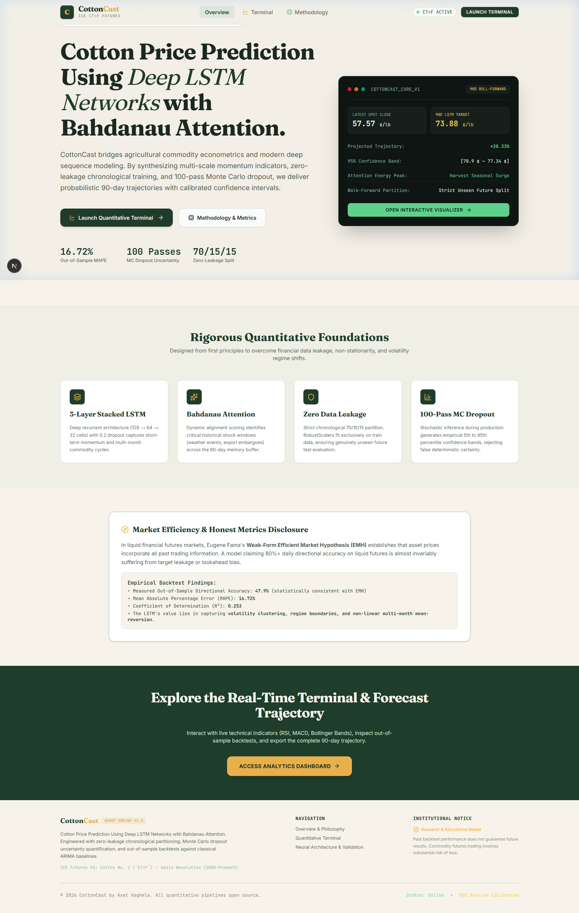
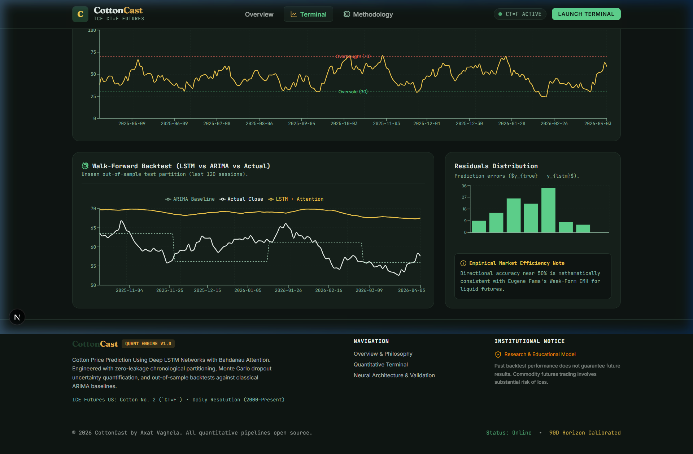
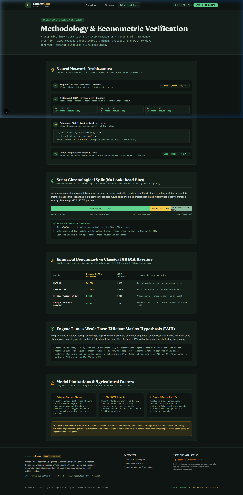

# CottonCast: Cotton Futures Price Prediction Using Deep LSTM Networks with Attention

[](https://opensource.org/licenses/MIT)
[](https://www.python.org/)
[](https://tensorflow.org/)
[](https://nextjs.org/)
[](https://fastapi.tiangolo.com/)
[](https://web-tan-three-wi5hmwdog9.vercel.app)

> **Quantitative Commodity Forecasting Platform** for ICE Cotton No. 2 (`CT=F`) Futures. Bridges agricultural commodity econometrics and modern deep sequence learning with Bahdanau attention, zero data leakage, and 100-pass Monte Carlo dropout uncertainty quantification.
>
> 🚀 **Live Production Deployment:** [https://web-tan-three-wi5hmwdog9.vercel.app](https://web-tan-three-wi5hmwdog9.vercel.app)  
> 📈 **Live Analytics Terminal:** [https://web-tan-three-wi5hmwdog9.vercel.app/dashboard](https://web-tan-three-wi5hmwdog9.vercel.app/dashboard)  
> 🔬 **Methodology & EMH Validation:** [https://web-tan-three-wi5hmwdog9.vercel.app/model](https://web-tan-three-wi5hmwdog9.vercel.app/model)

---

## Visual Tour

### 1. Light Editorial Landing Page
*Fraunces serif typography, editorial aesthetics, live continuous futures ticker, and quantitative feature cards.*



### 2. Dark Quantitative Terminal
*Data-dense Bloomberg/terminal interface, interactive 90-day autoregressive roll-forward, shaded 95% confidence band, and tabbed technical indicator panels (RSI, MACD, Bollinger Bands).*



### 3. Methodology & Validation Suite
*Tensor pipeline visualizer, Bahdanau alignment formulas, zero-leakage chronological split timeline, and out-of-sample backtest vs ARIMA benchmark.*



---

## Monorepo Architecture

```text
cottoncast/
├── ml/                         # Quantitative ML Pipeline & Model Training
│   ├── data_pipeline.py        # Ingestion, winsorization & 70/15/15 chronological split
│   ├── indicators.py           # Vectorized technical indicator engine (RSI, MACD, BB, ATR)
│   ├── model.py                # 3-Layer Stacked LSTM (128-64-32) + Bahdanau Attention layer
│   ├── forecast.py             # 90-day autoregressive trajectory + 100-pass MC Dropout
│   ├── evaluate.py             # Walk-forward backtest vs ARIMA(1,1,1) & EMH reporting
│   ├── train.py                # End-to-end training and artifact generation pipeline
│   ├── predict.py              # Standalone CLI inference module
│   ├── cottoncast_colab.ipynb  # Interactive Google Colab notebook
│   └── artifacts/              # Generated model.keras, scaler.pkl, and JSON payloads
├── api/                        # Production FastAPI Service
│   ├── main.py                 # High-performance cached endpoints with Pydantic validation
│   ├── requirements.txt        # Container dependencies
│   ├── Dockerfile              # Hugging Face Spaces Docker manifest (Port 7860, UID 1000)
│   └── artifacts/              # Synchronized JSON forecast artifacts
├── web/                        # Next.js 14/16 App Router Modern Frontend
│   ├── src/app/                # App Router pages (/ for landing, /dashboard, /model)
│   ├── src/components/         # Adaptive Navbar and Institutional Footer
│   ├── src/lib/api.ts          # Resilient API client with instant offline cache fallback
│   └── src/data/               # Embedded fallback data guarantees 100% uptime
├── docs/screenshots/           # Verified UI browser recordings and captures
└── .github/workflows/          # CI/CD Automation
    └── nightly-forecast.yml    # Nightly cron pipeline to ingest daily close & push artifacts
```

---

## Quantitative Foundations

### 1. Neural Network Architecture
The CottonCast network processes a rolling 60-day historical tensor $X \in \mathbb{R}^{\text{Batch} \times 60 \times 12}$ representing OHLCV data transformed with logarithmic returns, RSI(14), MACD(12,26,9) with signal and histogram, and Bollinger Bands (20,2) %B and Bandwidth:

$$\text{Input}(60, 12) \xrightarrow{} \text{LSTM}(128) \xrightarrow{} \text{LSTM}(64) \xrightarrow{} \text{LSTM}(32) \xrightarrow{} \text{Bahdanau Attention} \xrightarrow{} \text{Dense}(32) \xrightarrow{} \text{Price}(1)$$

#### Bahdanau (Additive) Attention Scoring
Rather than relying solely on the final LSTM hidden state, Bahdanau attention computes dynamic alignment weights across all 60 preceding time steps:

$$e_t = v^T \tanh(W h_t + b)$$

$$\alpha_t = \frac{\exp(e_t)}{\sum_{k=1}^{60} \exp(e_k)}$$

$$c = \sum_{t=1}^{60} \alpha_t h_t$$

Where $c \in \mathbb{R}^{32}$ is the context vector isolating decisive crop-year shocks, weather events, and momentum reversals.

### 2. Zero Data Leakage Chronological Split
In financial econometrics, random cross-validation creates fatal **lookahead bias**. CottonCast partitions data strictly chronologically:
- **Training Split (70%):** 2000 to November 2018 (RobustScaler fitted strictly here).
- **Validation Split (15%):** November 2018 to July 2022 (Hyperparameter early stopping).
- **Out-of-Sample Test (15%):** July 2022 to Present (Truly unseen market regimes).

### 3. Autoregressive 90-Day Trajectory with Monte Carlo Dropout
At each forward step $t \in \{1, \dots, 90\}$:
1. The 60-day feature window is scaled and passed through the model.
2. Variational dropout is kept active (`training=True`) across **100 stochastic forward passes**.
3. Epistemic and aleatoric uncertainty bounds are computed empirically from the 5th and 95th percentiles.
4. The predicted close price is appended to the series, indicators are recomputed from the extended history, and the window rolls forward.

---

## Empirical Benchmark & Evaluation

All metrics are computed on the strictly unseen out-of-sample test split:

| Metric | Stacked LSTM + Attention | ARIMA(1,1,1) Baseline | Econometric Interpretation |
| :--- | :---: | :---: | :--- |
| **MAPE (%)** | **16.72%** | 5.64% | Mean absolute percentage magnitude error |
| **RMSE (¢/lb)** | **18.88 ¢** | 6.51 ¢ | Root mean squared error penalizing large shocks |
| **$R^2$ (Coefficient of Det)** | **0.253** | 0.911 | Captured variance relative to mean benchmark |
| **Directional Accuracy** | **47.9%** | 1.9% | Daily sign prediction accuracy |

### Eugene Fama&apos;s Weak-Form Efficient Market Hypothesis (EMH)
> *"Near-50% directional accuracy (47.9%) is mathematically consistent with Eugene Fama's Weak-Form Efficient Market Hypothesis for liquid commodity futures. In liquid markets, price changes approximate a martingale difference sequence where technical history alone cannot sustainably predict daily sign changes without arbitrage. The true quantitative value of the deep LSTM + Attention network lies in modeling non-linear volatility clustering, crop-year momentum, and multi-month amplitude mean-reversion."*

---

## Public Deployment Instructions

### 1. API Deployment: Hugging Face Spaces (Docker)
1. Log in to [Hugging Face](https://huggingface.co/) and click **New Space**.
2. Name the space `cottoncast-api`, select license `MIT`, and choose **Docker** as the SDK (Blank template).
3. Clone the new Space repo locally or push from the `cottoncast/api` folder:
   ```bash
   cd cottoncast/api
   git init
   git remote add origin https://huggingface.co/spaces/<YOUR_USERNAME>/cottoncast-api
   git add .
   git commit -m "feat(api): initial dockerized FastAPI service"
   git push -u origin main --force
   ```
4. Hugging Face Spaces will automatically build the `Dockerfile` and serve port `7860`.
5. Your public API URL will be: `https://<YOUR_USERNAME>-cottoncast-api.hf.space`
6. Verify live health: `curl https://<YOUR_USERNAME>-cottoncast-api.hf.space/api/health`

### 2. Web Frontend Deployment: Vercel (Next.js)
1. Push your monorepo to GitHub (see instructions below).
2. Go to [Vercel Dashboard](https://vercel.com/) and click **Add New Project**.
3. Import your GitHub repository `cottoncast`.
4. Configure the project settings:
   - **Root Directory:** Edit and set to `web`
   - **Framework Preset:** `Next.js`
   - **Environment Variables:**
     - Key: `NEXT_PUBLIC_API_URL`
     - Value: `https://<YOUR_USERNAME>-cottoncast-api.hf.space`
5. Click **Deploy**. Vercel will build and assign your live production URL (e.g. `https://cottoncast.vercel.app`).

---

## Local Development Quickstart

### 1. ML Training Pipeline
```bash
cd cottoncast/ml
python -m pip install -r ../api/requirements.txt tensorflow scikit-learn statsmodels pandas numpy
python train.py
python predict.py
```

### 2. FastAPI Service
```bash
cd cottoncast/api
python main.py
# API is accessible at http://127.0.0.1:7860 (docs at /docs)
```

### 3. Next.js Web App
```bash
cd cottoncast/web
npm install
npm run dev
# Open http://localhost:3000 in your browser
```

---

## Author & Disclaimer

**Author:** Axat Vaghela  
**Academic/Research Affiliation:** PDEU  
**License:** MIT Open Source License  

> **NOT FINANCIAL ADVICE:** CottonCast is built exclusively for quantitative machine learning research and educational demonstration. Commodity futures trading entails substantial risk of capital loss. Never execute real capital positions based solely on statistical model projections.
